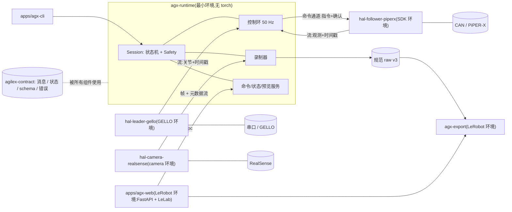

# AgileX 数采系统架构基线 v3.3:HAL 服务化重写

> 状态:**设计基线(架构冻结,实施及真机验收未完成)**,取代 v1(`ARCHITECTURE_REFACTOR.md`)和 v2(`ARCHITECTURE_REFACTOR_v2.md`)。
> 依据:`KnightOrNot/agilex` main(版本 0.2.1)及五个子模块的代码阅读、`.agents/` 项目约束,以及在你的 WSL 上的 `uv lock` 实测。
> 前提(你已确认):`agilex-controller`、`agilex-data-collection` 及四个自研子模块都是自己的代码,可以推倒重来;各组件解耦为独立服务,环境要求是次要的;GELLO 也做成服务。
> 已确认的决策(D9–D11):数据采集提供两种模式并由参数切换;**子模块保持独立仓库,不并入主仓库**;位置容差统一为 1.0° 并可在 toml 中配置。
> 当前设计:以设备契约连接独立 HAL 与统一 runtime,区分严格只读探测、设备准备和运动授权;使用 HAL 独立看门狗、明确的时间语义与 episode 边界。故障默认**报错停止**,保留已有回零校验;录制收尾采用可配置的有界期限,不能阻塞设备故障处理。PiPER-X 断令行为仍为 `unverified`,软件封装与仿真可以先行。决策与代码依据见 §0、§1;后续架构变更应来自测试失败、性能测量或实际设备差异,标注「待确认」的实施细节须在对应阶段核对。

---

## 0. 决策记录

| # | 决策 | 来源与理由 |
| --- | --- | --- |
| D1 | **硬件设备抽象为 HAL,每个 HAL 是独立进程**;环境是否独立**按需决定**(见 D2、§9)。组件之间只通过契约协议通信 | v1 的 HAL 思路 + 进程隔离。v1 的错误在于把所有设备包进同一个环境,与 LeRobot 在 numpy 上无解(附录 A) |
| D2 | **组件之间通过契约通信**:runtime 不 import 具体设备驱动;纯契约与工具代码可以被多方正常复用;**模块边界、进程边界、环境边界分别决定**,环境独立是允许而不是强制 | 评审指出「每个 HAL 专属环境、完全禁止 import」过于绝对。环境差异(附录 A)只是其中一个理由 |
| D3 | **runtime 管理会话与控制权,并拥有唯一的控制环**;**HAL 独占设备句柄**。两种所有权分开:谁能打开硬件(HAL),谁有权发运动命令(持有会话租约的 runtime) | 现状浏览器路径的 50 Hz 控制环在装着 torch、LeLab 的进程里;评审指出所有权需区分 |
| D4 | **GELLO 做成 HAL 服务**:先**包装现有库**建立服务边界,再单独**提取**所需代码(提取后置到 P7) | 评审指出提取范围依赖完整依赖链(见 §10),与服务化分开验证更稳 |
| D5 | **录制由一个录制组件负责唯一提交责任**(完整性、完成记录);图像搬运、序列化、写盘的执行位置(线程或独立进程)按 P0 测量结果决定,控制环只入队 | 评审建议:保留唯一提交责任,调整执行位置 |
| D6 | **LeRobot 只出现在导出器和 LeLab**,与实时路径完全隔离 | 导入耗时、GIL 竞争、体量都不应进入实时进程 |
| D7 | 对外发行名与命令名(`agilex-controller`、`agilex-data-collection`)保持不变,作为新应用的入口别名 | `project.md` 明文要求;改名需另写 ADR |
| D8 | 重写不丢行为:第 12 节的行为基线(当前 24 条)是验收标准;**标注【PiPER-X】的条目是兼容配置,通用 runtime 按设备描述工作** | 这些是真机调试积累的安全语义 |
| D9 | **数据采集两种模式都实现,由参数 `record.mode` 切换**:`full`(各流按自身原生频率记录,导出时匹配)与 `sampled`(采集时按数据集频率挑选并校验,额外保存目标采样时间与被选样本引用) | 你已确认。见 8.4 |
| D10 | **子模块保持独立仓库,不并入主仓库**;`agilex-adapters` 解散,`agilex-gello-software` 不再作为子模块,新增 `agilex-contract`、`agx-hal-gello` 两个子模块 | 你已确认。见第 11 节 |
| D11 | **位置容差统一为 1.0°,并作为 toml 参数可配置**(浏览器原来的 1.1° 取消) | 你已确认。这改变了浏览器路径的运动判定,见 7.5 与第 12 节第 13 条 |
| D12 | **公共契约不写死当前设备组合**:增加设备描述与能力声明,公共消息为「消息头 + 类型化载荷」;六轴加夹爪属于 PiPER-X 的设备描述与导出映射 | 评审第 1 条。只实现当前需要的载荷类型,不预建插件体系 |
| D13 | **记录按流进行,不绑定控制频率**:各流按各自频率保存并记录缺口;导出时再生成统一时间网格;在线保留陈旧/时钟异常检测 | 评审第 2 条 |
| D14 | **故障策略按「流角色」与「设备退出/故障策略」决定,不再统一回零**;本次对必需流异常与在线采样时间差超限保留**报错停止**,不启用「本段作废、控制继续」;PiPER-X 保留现有退出行为作为兼容配置;未验证的断令场景标 `unverified`,依赖它的真机验收须取得对应证据(见 7.2、7.2.1) | 评审及本轮定稿:保持行为基线,将策略变化与架构迁移分开 |
| D15 | **进程存在不等于获得运动权限;「严格只读」与「不产生从臂运动」是两种不同保证**:握手与探测严格只读;已声明副作用的设备准备(GELLO 示教初始化、相机开流)单独成阶段;从臂使能、写运动参数、对齐在运动确认后(见 5.7) | 现有 `GelloPiperXRobot.start()` 一次调用写运动限值并使能;GELLO 初始化写扭矩寄存器;相机启动设置 `global_time_enabled` |
| D16 | **状态机拆为通用采集生命周期与可选遥操作生命周期**,PiPER-X 的回零、七自由度检查、容差都是兼容配置(见 7.1) | 否则纯传感器采集与通用设备描述与状态机矛盾 |
| D17 | **录制完整性可核对**:开始前确认消费者就绪,结束时核对生产端最终序号与收到/写入/主动跳过/传输丢失/写盘失败各自数量,无法确认不发布成功完成记录;**边界确认与写盘不得阻塞设备故障处理**(见 7.4、8.2) | PUB/SUB 满队列会丢消息,末尾丢帧仅靠接收端序号发现不了;数据收尾不能成为故障处理的前置条件 |

---

## 1. 现状事实(代码核对)

### 1.1 模块

| 模块 | 实际内容 | 规模 |
| --- | --- | --- |
| `src/agilex_controller/` | CLI、生命周期(`workflow.py`)、控制环与 `move_js`(`control.py`)、SDK 子进程、raw 录制(`recording.py`)、相机会话与预览(`camera.py`) | 约 2.1k 行 |
| `src/agilex_data_collection/` | FastAPI 后端、`Session`(含 50 Hz 控制环与采样)、硬件 worker、预览编码 | 约 2.0k 行 |
| `agilex-sdk-python` | 自研 PiPER-X 驱动(基于 `pyAgxArm`)、CLI、GELLO 线协议 ZMQ server(pickle) | 约 1.9k 行 |
| `camera-realsense-d455f` | 自研 RGB-D 流库(依赖 PyPI `pyrealsense2`,不是 librealsense fork) | 约 2.0k 行 |
| `lerobot-converter` | raw → LeRobot v3 离线转换,`lerobot==0.6.1` | 约 0.7k 行 |
| `agilex-adapters` | LeRobot `Robot`/`Teleoperator` 子类 + ipc 客户端;`app` extra 装 LeLab、FastAPI、torch;`lerobot==0.6.0` | 很小 |
| `agilex-gello-software` | **唯一的上游 fork**(196 个文件,含 ros2、其他机械臂、仿真) | 大 |

### 1.2 已经出现的问题

| 问题 | 证据 |
| --- | --- |
| 两套生命周期 | `workflow.py::run_workflow` 与 `worker.py::Hardware.start/close` |
| 两个相机消费者 | `controller/camera.py::CameraSession` 与 `worker.py::Capture` |
| 两种原始数据 | raw v1/v2 与浏览器 `data/raw/app/` 审计格式 |
| 两条 LeRobot 写入路径 | converter(0.6.1,离线)与 `Session._dataset`(0.6.0,在线追加) |
| 两种采样语义 | CLI 记录控制频率、转换时取最近;浏览器在控制环内按 `dataset_fps` 采样并校验相机偏差 |
| 行为分叉 | `move_js` 容差 CLI 为 1.0°、浏览器为 1.1°,ADR 0001 专门解释 |
| 控制环在 Web 进程 | `session.py::_control` 每个 tick 至少两次 IPC,采样 tick 另有观测与帧请求;且该进程装着 torch/LeLab |
| 私有导入 | `worker.py` 里 `from agilex_controller.workflow import _shutdown` |
| pickle 通信 | SDK server TCP `127.0.0.1:6001`、`RobotClient`、worker ipc 三处 |

### 1.3 评审点的核对结果

| 评审指出 | 核对 | 处理 |
| --- | --- | --- |
| `agilex-adapters` 的 `PiperX`、`Gello` 并非「无调用者」 | **成立**。`session.py` 第 19、147–148 行导入并使用 `PiperX`、`Gello`、`BridgeClient`(我早先的检索排除了 `devices.py`,结论错误) | 4.2 已更正:迁移到 runtime 后才能移除,需替换调用路径并验证 |
| PiPER-X 驱动已检查反馈年龄 | **成立**。`driver.py` 有 `feedback_timeout`(默认 0.5 s),陈旧即报错 | 新契约承接「反馈年龄」,不只打发布时间戳 |
| 回零已有反馈与状态保护 | `control.py::move_js()` 开始前调用 `get_joint_state()`;经 `gello_follower.py` 到 `driver.py::get_state()` 检查 CAN、反馈有效性和新鲜度;每次 `command_joints()` 再校验状态、实际使能与目标跨度 | 7.2:提升为必须保留的 HAL 契约,不把「尝试回零」解释成无条件发送目标 |
| 夹爪反馈缺失时静默沿用缓存或命令值 | **成立**。`gello_follower.py::_joint_state_with_gripper` 捕获 `FeedbackError` 后沿用上次状态 | raw 增加来源标注(measured / command_filled),见 8.1 |
| 相机帧已有接收时间、设备时间与误差字段 | **成立**。`VideoFrame` 含 `received_time_ns`、`sdk_timestamp_ms`、`sdk_timestamp_domain`、`clock_offset_ns`、`clock_uncertainty_ns` | 新契约完整承接 |
| GELLO 提取依赖完整依赖链 | **成立**。`GelloAgent` → `Agent` 协议;`DynamixelRobot` → `Robot` 协议;`DynamixelDriver`(665 行)。涉及 5 个文件,实际 1,123 行(此处原写约 950 行有误,见 1.4),不含 quest/spacemouse 与其他机械臂 | §10 按完整链确认,并后置 |

### 1.4 对 v3.1 评审的核对结果

| 评审指出 | 核对 | 处理 |
| --- | --- | --- |
| GELLO 行数写错 | **成立,是我的错**:五个文件为 139 + 43 + 148 + 128 + 665 = **1,123** 行;我写的 950 只是三个主要文件(139+148+665=952),漏了两个协议文件 | §10 已更正;行数只用于估算,不作范围或验收标准 |
| `DynamixelRobot` 有状态 | **成立**:启动时按 `start_joints` 做 ±2π 的关节偏移展开(`robots/dynamixel.py`);`get_joint_state` 带平滑状态(`_alpha=0.99`、`_last_pos`) | 黄金测试改为完整输入序列加初始化条件加输出序列;服务化若改变 `GelloAgent.act()` 调用频率会改变按调用次数的平滑效果,P3 纳入对比 |
| SDK server 收不到命令时没有停止或保持 | **成立**:`gello_server.py` 接收超时后 `continue`,不执行停止或保持 | 7.2.1:不能据此认定硬件有断令保护 |
| 浏览器 worker 看门狗只是应用行为 | **成立**:超时抛异常进入清理 | 同上 |
| `end_fast_response_mode()` 只恢复 SDK 自动运动模式开关 | **成立**:调用 `set_auto_set_motion_mode_enabled(...)` | 同上,不能证明硬件已停止 |
| 现有 `start()` 在确认前路径里有硬件副作用 | **成立**:`gello_follower.py::GelloPiperXRobot.start()` 依次 `connect`、`maximize_joint_motion_limits`、`enable` | D15 与 5.7:启动与握手只读,使能延后到确认后 |
| 采样时间差超限的现有行为是报错停止 | **成立**:`session.py::aligned_frames()` 抛 `RuntimeError`,控制循环据此停止 | 7.2、8.4:本次确定保留;「只终止录制」不属于本次实施范围 |
| 缓存的测量值不应都标成 `command_filled` | **成立,采纳**,并更正我 v3.1 的建议 | 5.3:来源与新鲜度分开 |
| GELLO 初始化不是严格只读 | **成立**:`dynamixel/driver.py` 初始化调用 `set_torque_mode(...)`,对每个舵机写 `ADDR_TORQUE_ENABLE` 寄存器(注释:GELLO 必须处于无扭矩示教状态,任一舵机无响应即初始化失败);`.agents/constraints.md` 也明确 GELLO 的常规初始化会写扭矩关闭,不用于严格只读审计 | 5.7:GELLO 示教初始化归入「设备准备」,保留扭矩关闭保护;严格只读探针只允许 PING/READ |
| 相机启动不是只读 | **成立**:`stream.py` 启动时对传感器设置 `global_time_enabled` 并启动采集流(代码保存了原值,关闭时是否恢复待核对) | 5.7:相机配置与开流归入「设备准备」 |

---

## 2. 设计原则

1. **服务化解耦**:组件只通过契约通信,环境相互独立。
2. **单一控制环**:只有 runtime 里一个,只做读取、映射、限幅、发送,不做编码、磁盘 I/O、网络阻塞。
3. **设备失联与陈旧是一类事件,处理方式由流角色与设备策略决定**:统一进入事件路由,但不统一回零。
4. **行为不隐式改变**:容差、回零顺序、退出不失能等先冻结,改动必须单独决策。
5. **重写与迁移分开**:新实现与旧实现并行存在,达到验收基线后再切换。
6. **上游代码只提取、不背负**:带走需要的代码,保留版权与许可声明。

---

## 3. 总体架构



要点:

- runtime 与设备之间只有契约协议。
- CLI 直接嵌入 runtime(同进程);Web 通过 `BUS` 控制 runtime 守护进程,Web 自己不碰硬件。
- LeLab 与导出器在同一个 LeRobot 环境,不与实时路径共享进程。

---

## 4. 组件命名与边界

### 4.1 新组件

| 组件(分发名 / 导入名) | 环境 | 职责 | 不做什么 |
| --- | --- | --- | --- |
| `agilex-contract` / `agilex_contract` | 无硬依赖 | 消息 schema、状态枚举、错误类型、raw schema 常量与校验、ipc 客户端工具、设备描述、消息头与类型化载荷、命令通道协议(共享内存帧协议仅在测量后确有必要时加入) | 不含设备逻辑;不 import numpy 专有 API,数组以 `bytes + dtype + shape` 传输 |
| `agx-runtime` / `agx_runtime` | 最小环境(contract、pyzmq、msgpack、numpy) | Session 状态机、Safety、控制环、映射、硬件锁、录制器、命令/状态/预览服务、HAL 进程监管 | 不 import 任何设备库;不含 torch/LeRobot |
| `agx-hal-gello` / `agx_hal_gello` | GELLO 环境(dynamixel-sdk、numpy) | Leader 服务:读取主手,发布最新关节与夹爪(带采样时间与来源标注),真机保护与串口清理 | 不做 leader→follower 映射(属 runtime) |
| `agx-hal-piperx` / `agx_hal_piperx` | SDK 环境(`pyAgxArm`、`python-can`) | Follower 服务:CAN、反馈、指令、`move_js`/归零原语、SDK 子进程自身的生命周期;**启动分两阶段**(握手只读,确认后才使能与写运动参数,见 5.7) | 不含跟随逻辑与 Safety 策略(属 runtime);只含硬件级限幅兜底 |
| `agx-hal-realsense` / `agx_hal_realsense` | camera 环境(`pyrealsense2`) | Camera 服务:profile 选择、预热、时钟映射、标定,发布带时间语义的帧与元数据(默认 ZMQ 多帧消息,必要时共享内存) | 不含预览编码、不含 raw 写入、不含机器人客户端 |
| `agx-export` / `agx_export` | LeRobot 环境 | Exporter:读规范 raw,校验、时间匹配,写 LeRobot v3;离线整段与在线追加两个入口共用同一份逻辑 | 不依赖 runtime;不覆盖已有输出 |
| `apps/agx-cli` | 与 runtime 同环境 | 参数解析、终端确认(`yes`)、键盘 R/S/D、信号接入、自动导出触发 | 不含硬件初始化、清理或安全逻辑 |
| `apps/agx-web` | LeRobot 环境 | FastAPI、预览编码、点云、LeLab 同源代理、数据集浏览/合并/上传/本地删除 | 不碰硬件、不含控制环 |
| `agx-sim` | 与 runtime 同环境 | 三个 HAL 的假实现,同样说契约协议;用于测试与无硬件调试(取代现有 `Simulation`) | — |

### 4.2 旧 → 新映射

| 旧 | 新 | 处理 |
| --- | --- | --- |
| `agilex_controller/workflow.py` | `agx_runtime` 的 session、locking、signals、supervisor | 重写,状态机化 |
| `agilex_controller/control.py` | `agx_runtime` 的 motion、safety | 重写;`limit_arm_command`、起始偏差检查进入 Safety,单独单测 |
| `agilex_controller/gello.py` | `agx_hal_gello` + runtime 中的映射 | 拆分 |
| `agilex_controller/robot_client.py` | `agx_runtime` 里的 follower 客户端(说新契约)+ 可选 GELLO 线协议兼容层 | 重写 |
| `agilex_controller/camera.py`、`worker.py::Capture` | `agx_hal_realsense` + runtime 录制器 + web 预览 | 合并为一份 |
| `agilex_controller/recording.py` | `agx_runtime` 录制器 | 保留 `.partial` → 原子发布语义 |
| `agilex_controller/configuration.py`、`data_collection/config.py` | `agx_runtime` 单一配置模型 | 浏览器覆盖项(`hz`、容差)显式表达 |
| `agilex_data_collection/*` | `apps/agx-web` | 删除其中的硬件代码与控制环 |
| `agilex-sdk-python`(子模块) | `agx-hal-piperx`(**仍是子模块**,仓库可改名) | 内部驱动逻辑可复用;server 改说新契约;保留 GELLO 线协议兼容端点作可选项 |
| `camera-realsense-d455f`(子模块) | `agx-hal-realsense`(**仍是子模块**) | 流库复用;删除 `opencv-python` 声明(`src/` 未使用,仅示例脚本用) |
| `lerobot-converter`(子模块) | `agx-export`(**仍是子模块**) | 扩展 `append_episode` 入口与两种记录模式的处理 |
| `agilex-adapters`(子模块) | **解散**,从 `.gitmodules` 移除 | ipc 客户端并入 contract;`PiperX`、`Gello` 等 LeRobot `Robot`/`Teleoperator` 子类**目前被浏览器 `Session._control()` 使用**,runtime 接管控制环并验证行为后才能移除;`app` extra 并入 web 环境 |
| `agilex-gello-software`(fork 子模块) | **提取**进新子模块 `agx-hal-gello`;原 fork 移出子模块列表,仓库保留作为上游参考 | 见第 10 节 |

### 4.3 命名规则

- 自研组件统一前缀 `agx-`(分发名)/ `agx_`(导入名),前缀可替换,但全项目一致。
- 按职责命名,不按来源命名;不使用 adapters、framework 这类泛称。
- HAL 一律 `agx-hal-<设备>`。
- 对外命令 `agilex-controller`、`agilex-data-collection` 保留为入口别名。

---

## 5. HAL 契约

### 5.1 设计要点

- 公共契约 = **消息头 + 类型化载荷 + 设备描述**。不留「任意字典」让各设备自行解释。
- 具体设备组合(PiPER-X 的六轴加夹爪、七维 action)属于**设备描述与导出映射**,不进公共协议。
- 先只实现当前需要的载荷类型,不预建插件注册表;新增设备类型时增加载荷与描述,不改已有消息。
- 单位固定:rad、rad/s、m、N、N·m、xyzw 四元数。

### 5.2 设备描述(DeviceDescriptor)

每个 HAL 启动握手时声明:

| 内容 | 说明与示例 |
| --- | --- |
| 设备身份 | 稳定设备 ID、型号、序列号、驱动版本、`schema_version` |
| 控制能力 | 例如关节位置命令(关节名、限位、最大速度)、夹爪开度命令(范围);以后按实际需要扩展 |
| 数据流(StreamSpec) | 流名称、种类、数据类型、维度、单位、坐标系、标称频率 |
| 运行约束 | 支持频率、有效性规则、超时、数据陈旧阈值 |
| 故障与退出策略 | 引用设备策略(见 7.2),例如 PiPER-X 的 `exit_policy` |

**流角色与检查生效阶段由 runtime 的会话配置声明**,以设备 ID 与流名称关联 `StreamSpec`(见 7.2、9.1),不是 HAL 固有属性。HAL 描述能力与设备有效性约束;runtime 校验本次用途是否满足这些约束,不能通过修改角色绕过命令校验或设备保护。

### 5.3 消息

**公共消息头**:`schema_version`、`device_id`、`stream`、`seq`、`stream_epoch`(服务每次启动生成新值,避免重启后序号归零造成混淆)、`validity` 标志。

**时间字段必须表示真实数据年龄**,至少区分:

| 字段 | 含义 |
| --- | --- |
| `t_sample` + `clock_domain` | 设备采样时间及其时钟域 |
| `t_host_rx_mono_ns` | 主机首次收到这个**新样本**的时间 |
| `t_publish_mono_ns` | 服务发布时间 |
| `t_runtime_rx_mono_ns` | runtime 接收时间 |
| `clock_uncertainty_ns` | 时钟转换误差;并标注是否有效 |

- **重复发布旧值时不得附上新的采样时间**;用 `validity.new_sample=false` 与 `stale` 表示,避免上层误以为设备持续产生新反馈。
- **来源与新鲜度分开标注**:`origin` ∈ `measured` / `estimated` / `command_filled` / `unknown`;`freshness` ∈ `live` / `cached` / `stale`;缓存值同时保留**原始采样时间**。历史实测值缓存后仍是 `measured`,同时标 `cached`;**只有用命令补出的值才是 `command_filled`**;初始化默认值标 `unknown` 或无效。例如现 `gello_follower.py::_joint_state_with_gripper` 在夹爪反馈缺失时沿用上次状态或命令:沿用上次实测是 `measured` + `cached`,沿用命令才是 `command_filled`。
- 当前只保证**同机**单调时钟可比较;将来跨主机部署时,不能直接比较两台机器的单调时钟,需要显式时钟同步。

**类型化载荷(当前需要的)**:`JointState`(关节名、位置、速度、可选力矩)、`PoseState`(`ee_pos_quat`)、`ImageFrame`(RGB)、`DepthFrame`(原生 Z16、深度尺度)。力传感器的 `WrenchSample`(力、力矩、坐标系、力矩参考点、零偏与标定版本)**先只在 `agx-sim` 中作为验证用的假设备**,真有硬件再落地。

### 5.4 命令通道、会话与看门狗

- **配置、握手、状态查询、离散命令**(使能、模式切换、`move_js` 步、`authorize`)走同步请求/应答,不被覆盖。
- **连续控制命令**走独立单向通道加确认流;控制线程**不得每个 tick 同步等待回复**。
- **发送必须有界且不阻塞**:控制线程写入有界本地队列或使用非阻塞发送并处理发送失败(ZeroMQ 的 PUSH 在队列满时默认阻塞,必须配置为非阻塞与明确的高水位)。队列满时按策略处理(默认丢弃旧目标),并记录计数。
- **连续位置目标「最新值覆盖」**:尚未执行的旧目标被新目标取代;只有离散命令保证顺序。
- **命令字段**:`session_id`、会话租约 `lease`、`cmd_seq`、`issued_mono_ns`、`expires_mono_ns`。
- **会话接管**:HAL 在握手时只向一个会话授予租约;新会话接管需要旧租约显式释放或过期;HAL 拒绝旧 `session_id` 或旧租约的命令。runtime 重启必须重新握手。
- **确认状态**:`received`(HAL 收到)、`accepted`(通过校验)、`submitted`(已提交给 SDK/驱动)、`rejected`(带原因)。**协议不提供「已执行」断言**:SDK 调用成功通常只证明软件发送路径成功;目标是否到达由反馈状态流判断(runtime 自己计算 `reached`)。
- **`expires_mono_ns` 的含义**:命令在 HAL **接收/提交前**的有效期,过期则拒绝;**不是**硬件目标会在该时刻自动失效。
- **确认超时**:runtime 在 `ack_timeout` 内收不到有效确认(或确认流陈旧)即视为通道故障,进入该设备的故障策略。
- **runtime 或 HAL 崩溃、被强杀时机械臂会停在哪里**取决于设备策略,**不能用软件保护假设**,见 7.2.1。可处理的退出(正常停止、SIGTERM)会执行清理;强杀与崩溃无法保证执行清理代码。

### 5.4.1 HAL 本地命令看门狗(正式契约)

runtime 的 `ack_timeout` 检测不了「runtime 已经停止」:runtime 崩溃时它自己的检查也一起停止。所以 HAL 必须**独立**检测。

- **适用范围**:需要连续命令的状态(跟随)。对齐阶段适用单独规则(见下)。
- **独立且不依赖下一条命令**:检测由 HAL 自己的定时器或线程执行,**不能等下一条命令到达才触发**。
- **触发条件**:距上一条**有效**命令超过 `command_timeout`,或会话租约失效、被撤销。
- **有效命令的界定**:状态查询、被拒绝的命令(过期、旧租约、校验失败)**不得延长**有效控制命令的期限。
- **触发后软件必须做到**:① 撤销该会话的命令执行权限;② 作废所有待执行目标;③ 进入设备规定的故障处理流程。**重新获得租约不自动恢复 ACTIVE**,必须重新经过 `authorize` 与对齐。
- **阶段规则**:
  - 对齐阶段(`move_js` 分步):每一步有自己的步超时,整个对齐有总超时;两步之间的间隔超限同样视为看门狗触发。
  - 连续跟随阶段:`command_timeout` 约束连续目标的到达间隔。
  - 具体数值由设备策略与实测确定,契约里只规定「必须有、必须独立、触发后必须做什么」。
- **分开记录两件事**:①「软件能够保证的动作」(撤销权限、停止转发、作废目标、进入故障流程);②「硬件最终停在哪里」(设备策略,PiPER-X 保持 `unverified`,见 7.2.1)。硬件行为未知,不妨碍先把 HAL 必须检测和处理什么定义清楚。

### 5.5 帧传输:先测量,再决定

- 默认用 ZMQ 多帧消息(元数据 + 原始字节)传输图像。
- **先测量**序列化、复制、吞吐、延迟分位数、队列占用与丢帧。满足则不引入共享内存;不满足再做。
- 若采用共享内存,必须先写清:槽位所有权;写入中标记(写前后各更新序号并由读取端复核,单靠「两次读到相同 `seq`」不足以排除读到混合数据);读完后数据是否仍可能被覆盖;**慢消费者**策略;**回收者**。
- 慢消费者:预览可以跳帧,优先降低延迟;录制器必须检测丢帧,按策略标记缺口或使 episode 失败;控制环使用最新且未过期的数据,并**记录实际使用的样本序号**。
- 共享内存由 runtime 创建并负责回收;服务退出或重启时使用新的 `stream_epoch`。

### 5.6 设备契约测试

每个 HAL 必须通过同一套契约测试:单位、通道顺序、时间戳语义(含重复值不刷新采样时间)、超时、重启(`stream_epoch` 变化)、清理。性能验收记录**延迟分位数、超期次数、队列占用、丢帧**,不只看平均 Hz。

### 5.7 HAL 生命周期与权限

**进程存在,不等于获得运动权限。「严格只读」和「不产生从臂运动」是两种不同的保证。**

| 阶段 | 允许 | 禁止 | 授权范围 |
| --- | --- | --- | --- |
| DISCOVER(进程启动、握手、探测) | **严格只读**:身份、固件、能力、状态、反馈、健康;GELLO 只允许 PING/READ 探针;相机只枚举设备与读能力 | 写任何设备寄存器或选项、开流、使能、写运动限值、切换控制模式 | 无需额外授权 |
| PREPARE(设备准备) | **已声明副作用**的准备动作:GELLO 示教初始化(关闭舵机扭矩)、相机配置与开流(如设置 `global_time_enabled`、预热) | 从臂使能、写运动参数、发送运动命令 | session 启动时授权,**副作用必须写在设备描述里** |
| AUTHORIZED(运动确认后,runtime 发 `authorize{session, lease}`) | 写运动参数、使能(是否幂等由设备策略声明) | 连续运动命令(尚未对齐) | 用户确认运动 |
| ACTIVE | 接收连续命令(受 5.4.1 看门狗约束) | — | 持有租约 |
| RELEASED | 按设备退出策略释放 | — | — |

要点:

- **每种设备准备动作必须在设备描述里声明副作用与授权范围**,不一定增加状态,但不能含糊。
- **不得为了满足「只读」字面要求而删除 GELLO 原有的扭矩关闭保护**:它是示教安全所需,应归入 PREPARE。严格只读探针只能用于审计场景,不替代正常初始化。
- 现有 `GelloPiperXRobot.start()` 一次调用内 `connect` → `maximize_joint_motion_limits` → `enable`。**P3 不能把它直接包进服务启动**:拆成 DISCOVER(`connect` 与只读状态)和 AUTHORIZED(运动限值与 `enable`)。`driver.connect()` 本身是否有硬件副作用待核对。
- CAN 的配置与就绪检查属于主机层预检,不属于 HAL 握手。
- `DynamixelRobot` 的 `start_joints` 展开需要当前关节值,是在 PREPARE 之后(扭矩已关、可读)进行的只读读取。
- 对用户而言,GELLO 初始化与相机开流会发生在运动确认**之前**(现有 CLI 也是先读 GELLO、再等确认);它们不产生从臂运动,但**不是只读**,文档与界面不得称其为只读。

---

## 6. 传输与安全

| 链路 | 传输 | 说明 |
| --- | --- | --- |
| runtime ↔ HAL(握手、状态查询) | ZMQ `ipc://` + msgpack + schema | 同步请求/应答 |
| runtime → HAL(连续控制命令) | 独立单向通道 + 确认流 | 见 5.4 |
| HAL → runtime(数据流) | 发布/订阅,推送最新值与带时间语义的样本 | 见 5.3 |
| 图像 | ZMQ 多帧消息(默认);共享内存(经测量必要时) | 见 5.5 |
| Web ↔ runtime 守护进程 | ZMQ `ipc://` + msgpack | 沿用命令看门狗(`watchdog_s=1.0`)、owner 校验 |
| 浏览器 ↔ Web | HTTP + WebSocket | 预览 generation/sequence 防跨会话缓存;viewer 上限在 accept 前占位 |
| 外部 GELLO 工具链 ↔ follower | GELLO 线协议(pickle,`127.0.0.1`) | **可选兼容端点**,默认关闭;pickle 反序列化等价于代码执行 |

所有 socket 权限 0600、owner 校验;默认不开 TCP。

注意:**发布/订阅在订阅端队列满时会丢消息**,所以仅靠接收端序号无法发现「最后几帧丢失且之后没有新消息」。完整性核对见 8.2。

---

## 7. Runtime

### 7.1 生命周期

**通用采集生命周期**(所有设备组合,包括纯传感器采集):

```
IDLE → PREPARING → READY ⇄ RECORDING → FINISHING → CLEANUP → (EXPORTING) → IDLE | FAILED
任意 → STOPPING(应用各设备的退出或故障策略)→ CLEANUP
```

**可选遥操作生命周期**(设备描述含控制能力并配置了 Leader 时启用,嵌在 READY 前后):

```
CONFIRM → AUTHORIZE → ALIGN → FOLLOWING        (RECORDING 可在 FOLLOWING 中开关)
```

| 状态 | 通用动作 | PiPER-X 兼容配置下的具体动作 |
| --- | --- | --- |
| PREPARING | 获取硬件锁;拉起各 HAL 并握手(**DISCOVER,严格只读**);随后执行**设备准备(PREPARE)**:已声明副作用的动作,如 GELLO 示教初始化、相机配置与开流;校验配置 | CAN 配置/就绪检查(主机层)、GELLO 串口权限与示教初始化(写扭矩关闭)、`status` 反馈校验(七自由度:6 臂加夹爪) |
| READY | 必需流就绪且新鲜;录制消费者就绪 | 相机时序验证(开流已在 PREPARE 完成) |
| CONFIRM | 显示目标并等待确认 | 显示 GELLO 关节与目标;CLI 输入 `yes`,浏览器勾选加后端 guard |
| AUTHORIZE | 向各 HAL 发 `authorize`(5.7) | 写运动限值、使能 |
| ALIGN | 按设备描述对齐 | `move_js` 回零再对齐 GELLO(容差见 7.5) |
| FOLLOWING / RECORDING | 控制环;录制可开关 | 六个臂关节限幅,夹爪单独限幅 |
| STOPPING | 停止发送新的跟随目标;故障时立即撤销原跟随会话权限并作废待执行目标;对每个设备应用**退出策略(正常)或故障策略(异常)**,不等待录制收尾(见 7.4) | 关闭跟随连接与 GELLO 串口;**用新连接尝试小步回零,每步受 7.2 的已有校验约束**,再停止自己拥有的服务,不失能 |
| CLEANUP | 按 7.4 停止自己拥有的 HAL;关闭相机并刷新;刷新 raw;仅对满足完整性与质量要求的 episode 发布完成记录 | — |
| EXPORTING | 仅在正常清理且存在已保存 episode 时自动导出 | — |

- 通用 runtime **不假设机械臂存在、不假设七自由度、不假设统一回零**;这些都来自设备描述与设备策略。
- `--existing-server`(连接已有 Follower 服务)是 PREPARING 的一个分支:跳过本地 CAN 与服务管理,其余状态不变。

### 7.2 事件、流角色与故障策略

统一事件:SIGINT/SIGTERM、RPC 失败、看门狗超时、磁盘失败、HAL 失联/陈旧、Web 的 stop。**事件统一路由,但处理方式由流角色与设备策略决定**。

**流角色**(由 runtime 会话配置按流声明,与检查生效阶段分别配置):

| 角色 | 含义 | 失联或陈旧时 |
| --- | --- | --- |
| `control_required` | 闭环控制必需(Leader 关节、Follower 反馈) | 停止发送新指令,进入该设备的故障策略 |
| `record_required` | 录制必需(正在录制的相机、传感器) | **报错停止**:当前 episode 标记失败并记录缺口(保留 `.partial`),停止跟随并进入设备退出或故障策略 |
| `optional` | 仅显示或辅助 | 只告警 |

**本次有意让两个必需角色采用相同的停止策略,以保留行为基线。**角色表达用途依赖(控制必需或录制必需),不因当前处理动作相同而合并;后续若引入「本段作废、控制继续」,只调整录制故障策略,不改变控制依赖。

**本次默认与实施范围已确定:必需流丢失、陈旧或在线采样时间差超限时,保留报错停止。**这里的「停止」指停止跟随并执行设备退出或故障策略,不是硬件立即静止的保证;PiPER-X 兼容策略仍可能尝试回零。若有正在录制的 episode,保留不完整数据与错误原因,不发布成功完成记录。

runtime 的单一配置入口按 `device_id` / `stream` 保存每流策略,字段为:

| 字段 | 含义 |
| --- | --- |
| `role` | `control_required` / `record_required` / `optional`;同一流同时参与控制与采集时,故障处理采用 `control_required` |
| `monitor_when` | 启用在线有效性、陈旧与质量检查的运行阶段集合;通用采集阶段或遥操作阶段任一匹配即生效。表示检查范围,不授予运动权限,也不能关闭 HAL 的命令校验 |

**兼容配置必须显式设置已启用相机的 `monitor_when`,覆盖原有的非录制跟随阶段与录制阶段**,并保留启动时的就绪检查;不能仅因未录制就自动降为 `optional` 或跳过缺帧与时间差检查。相机用于采集时声明 `record_required`,仅用于独立预览时可显式声明 `optional`。HAL 不硬编码本次任务用途;角色、检查阶段及其兼容默认值由 runtime 配置模型统一校验(见 9.1)。控制必需流的检查必须覆盖所有消费它的控制阶段。

**「本段作废、控制继续」仅作为后续可选策略,本次不实现或启用。**后续引入时需单独记录行为变更并验收:仅允许对 `record_required` 的录制质量故障使用,且 Leader、Follower 反馈、控制通信与看门狗均正常;不得覆盖 `control_required` 故障或其他设备故障策略,也不得静默跳过坏样本后将本段标为完整。

**退出与故障策略是设备属性**,不是通用的「统一回零」:

| 场景 | 处理 |
| --- | --- |
| 正常结束 | 执行经确认的设备退出策略。PiPER-X:用新连接尝试小步回零,满足下述已有校验后才发送目标,再停止自己拥有的服务,不失能(沿用现有约定) |
| 通信或反馈异常 | 先进入设备支持且已验证的故障处理状态(停止发送并保持等),**不默认回零** |
| 恢复与回零 | 状态与授权条件满足后执行;回零会产生运动,接触、装配、反馈异常时是否允许需单独判断 |

PiPER-X 当前「异常退出也尝试回零」的行为作为兼容配置保持,并继续按项目约定验收;**新增设备必须显式声明策略,不继承回零**。状态表中 STOPPING 对每个设备应用其策略;对当前 PiPER-X,正常退出的策略就是小步回零。

**PiPER-X 回零的已有保护必须成为显式 HAL 契约**(代码依据见 1.3):

- 回零开始前读取并验证当前状态;每次发送关节目标前重新校验 CAN 通信、反馈有效性与新鲜度、设备状态、实际使能和目标限位/跨度。反馈陈旧阈值来自设备运行约束,不得以新发布时间刷新旧反馈的年龄。
- 任一校验不通过,拒绝该次目标并中止本次回零尝试,报告原因;不得为完成清理而绕过驱动校验。这里保证的是**不发送新的回零目标**,不是硬件已经静止;后续硬件行为仍按 7.2.1 的验证状态记录。
- 有效且新鲜的反馈只是必要条件。接触、装配等任务能否回零仍须由该任务的设备退出策略与授权范围决定,不能仅凭反馈正常推断运动许可。
- 上述条款显式保留现有保护;本次不新增「只要发生过通信故障,即使恢复也必须重新授权才能回零」等策略。若改变故障后的恢复/授权规则,应单独决策、记录并验收。

规则沿用现状:初始化阶段中断延迟到资源所有权建立之后;清理阶段屏蔽重复停止信号;RPC、回零、磁盘失败不被吞掉;**退出不自动 reset 或失能**。

### 7.2.1 设备策略与验证状态

「不自动失能」只约束**软件不能擅自做什么**,并没有定义机械臂会停在哪里。「继续追踪最后目标」「保持故障发生时的位置」「停止驱动输出」是不同的结果。

- 设备策略**绑定型号、固件版本、控制模式与 SDK 版本**,分别记录三种情形的行为:**runtime 停发**、**HAL 崩溃**、**通信链路中断**。其他固件版本的结论不能替代当前设备的验收。
- **未验证的项一律标 `unverified`,不得用「默认保持」填空。**
- 从当前代码**不能**确认 PiPER-X 在这三种情形下的硬件行为:
  - `gello_server.py` 接收超时后直接 `continue`,没有停止或保持动作;
  - 浏览器 worker 看门狗超时后抛异常进入清理,这是应用行为,不能证明机械臂自身有断令保护;
  - `end_fast_response_mode()` 恢复的是 SDK 自动设置运动模式的开关,不能据此认定硬件已停止。
- **真机接入门槛**:依赖这一策略的**真机运动与故障注入验收**要等对应证据(固件文档与受控实测)。**不阻塞整个重构**:P1、P2 仿真与 P3 的软件封装可以继续。
- **证据获取与正式验收分开**:先核对对应版本的固件资料,再为仍未知的场景制定专项受控测试;测试经单独授权,按项目硬件约束由操作员在场执行。该测试用于查清断令行为,不要求预先已有实测结论;结果记录测试条件、硬件实际响应与证据位置,再据此完成依赖该行为的正式验收。未覆盖的场景继续标 `unverified`,仿真通过或软件看门狗触发不能代替硬件证据。

### 7.3 Safety

独立模块,可单测:按**设备描述**对关节、夹爪限幅(**六个臂关节加独立夹爪是 PiPER-X 的配置**),起始偏差检查、数据陈旧看门狗(按 `StreamSpec` 的陈旧阈值)、控制线程停止看门狗、命令过期与旧命令拒绝。限制参数来自配置并在启动时校验。

### 7.4 进程监管

runtime 拥有它拉起的 HAL 进程:记录 PID、握手、监控 `health`。**设备退出/故障处理与录制收尾分别推进,故障处理不以保存成功为前提。**

- **仅结束一段录制、继续会话**:按 8.2 有界完成边界确认与数据收尾,HAL 可继续供预览和控制使用;此期间若发生故障,立即进入故障处理。
- **正常结束会话**:停止发送新的跟随目标,立即启动各设备的退出策略。若有未保存的 episode,固定其结束边界,对仍可用的生产端有界获取对应序号与计数;边界确认和数据排空不阻塞设备退出策略,退出动作产生的后续样本不计入该 episode。
- **发生故障**:立即停止发送新的跟随目标、撤销原跟随会话权限并作废待执行目标,进入设备故障策略。边界确认、队列排空、磁盘写入、完成记录发布均不得成为这些动作的前置条件。对仍可用生产端的边界确认只能有界尝试;失联、超时或因故障处理无法继续取数时,保留 `.partial` 并记录原因,不等待生产端恢复。
- **资源释放**:设备退出或故障策略执行结束(含失败或超时)后,停止自己拥有的 HAL;不为等待录制成功而延迟必要的设备释放。PiPER-X 仍按兼容策略用新连接尝试小步回零,终端 Ctrl+C 不会提前杀死其所需的 Follower 服务;退出动作按设备策略执行,不恢复原跟随会话权限。最后刷新已接收的图像与 raw,按 8.2 判断是否可发布完成记录;主错误与清理错误分开报告。

**并发约束**:边界确认、队列排空和磁盘 I/O 不得占用控制线程或阻塞故障处理;也不能通过持有共享锁、占满串行任务队列或等待录制工作线程退出,使故障动作间接排在录制任务之后。HAL 的命令撤销与看门狗处置同样不能等待录制边界 RPC。允许共用非阻塞事件循环,不强制线程数量或进程布局,但必须在阻塞故障注入下证明故障处理能独立推进。超时检测自身不得依赖被阻塞的录制执行单元,等待超时不代表底层 I/O 已取消;迟到结果的处理见 8.2.1。

生产端仍可用且不妨碍设备处置时,应在关闭前取得 episode 边界与计数;**这不意味着全部数据写盘完成后才能处理故障或关闭 HAL**。已取得的元数据与已接收数据足以完成后续核对时,录制器可在 HAL 关闭后继续收尾;不足时如实标记不完整。

### 7.5 位置容差(统一为 1.0°,可配置)

- 回零与对齐用的 `move_js` 位置容差只有一个参数:`motion.position_tolerance_deg`,**默认 1.0**,写在 `config/default.toml`,CLI 与 Web 共用,不再有各自的默认值。
- 这取代了现状的分叉(CLI `move_js` 默认 1.0°、浏览器 `position_tolerance_deg=1.1`)以及 ADR 0001 对该分叉的说明,需要在 ADR 0004 里记录。
- **这改变了浏览器路径的运动判定**:从 1.1° 收紧到 1.0°,对齐可能更难满足或更慢。必须在真机上验证对齐与回零不会因为超时而失败(P3 验收项)。
- 键名是建议,落地时对齐现有 `config/default.toml` 的表结构(待确认)。

---

## 8. 数据面

### 8.1 规范 raw(v3)

**不再称为旧格式的「超集」**:`observation_time_ns` 的含义改变,时间语义也更细。

- **以 episode manifest 为核心**,描述所有参与的数据流:设备 ID、`StreamSpec`、频率、序号范围、`stream_epoch`、缺口、标定引用、来源标注。各流保存自己的时间戳字段与序号,按流存放(目录或文件)。
- **完成记录**(`complete.json`,最后原子写入)确认 manifest 中的**必需流**已全部提交,并给出每流统计。这取代「joint JSONL 最后发布作为完成标记」,所以**纯相机、纯力传感器、独立标定采集**的 episode 也合法。
- 保留:`.partial` → 原子发布;孤立目录不被导出;一个 session 一个数据集,不覆盖。
- **时间语义**:保存 `t_sample`(含时钟域)、`t_host_rx`、`t_publish`、不确定度。控制命令流记录 `command_time` 与**所用观测的序号**。
- **来源与新鲜度**:每个样本或流标注 `origin`(`measured` / `estimated` / `command_filled` / `unknown`)与 `freshness`(`live` / `cached` / `stale`),缓存值保留原始采样时间(见 5.3)。力传感器带单位、坐标系、力矩参考点、零偏、标定版本。
- **PiPER-X 的六轴加夹爪、七维 action 是该设备的导出映射**,不是 raw 的通用结构;当前 LeRobot 数据集仍导出为 7 维,第 7 维是夹爪。
- **旧数据迁移**(`migrate-raw`)只读源、写新目录:保留原始时间语义(旧的「观测时间约等于客户端接收时间」),缺失的采样时间标为**未知**,**不通过转换补造**。

### 8.2 录制与完整性核对

- **一个录制组件负责唯一的提交责任**:完整性与完成记录。图像搬运、序列化、写盘的**执行位置**(线程或独立进程)按 P0 测量结果决定;控制环只入队。
- 按流保存,检测并在 manifest 记录缺口;写盘失败必须可见,并触发 STOPPING。
- **边界属于具体 episode**:设备可能在录制前就持续发布,保存后也可能继续为预览发布,所以「最终序号」必须说明属于哪一个 episode。**每个参与流**在 episode 记录里明确写出:`episode_id`、`device_id` / `stream` / `stream_epoch`、`first_seq`、`last_seq`(以及计数)。
- **保存流程(数据提交顺序,不约束设备故障处理的启动)**:
  1. 确定本 episode 的**结束边界**。
  2. 在 `record.boundary_timeout_s` 的 episode 级期限内取得各生产端**对应边界**的确认(生产端报告该边界内的最终序号与计数)。生产端可用时应在关闭前取得这些元数据;失联、超时或设备故障处理要求先释放资源时,标记不完整,不等待恢复(见 7.4)。
  3. 接收并写完边界内的数据;排空与提交阶段受 `record.drain_timeout_s` 约束(见 8.2.1),**超时则标记不完整**。
  4. 核对并**分开记录**:收到的、写入的、因 `capture_fps_max` **主动跳过**的、**传输丢失**的、**写盘失败**的。主动降采样不得与传输丢帧、写盘失败混在一起。
  5. **最后**发布完成记录。必需流的完整性无法确认,或本段因必需流缺失、陈旧、在线采样时间差超限等质量故障已标记失败时,**不发布成功的完成记录**(保留为 `.partial` 或标记失败)。
- **故障优先**:上述任何阶段发生设备故障,均立即执行 7.4,不得等待本保存流程结束。边界确认有超时,数据排空与写盘也有超时;取得元数据不等于必须把 HAL 保持到写盘完成。
- **开始边界**:开始录制前,确认每个必需流的接收端已就绪(订阅已建立、最近样本新鲜);`first_seq` 在开始时刻确定,不把开始之前的数据算进本 episode。
- 正常路径应避免无故先关闭生产端而丢失最终计数,并排除下一段与退出动作产生的样本;故障路径允许计数无法取得,但必须如实保留不完整状态。具体消息名称与文件布局在 P1/P2 确定。
- `sampled` 模式额外保存每个被选样本的**目标采样时间**与**各流样本引用**,使导出器能准确恢复采集时选定的组合。
- 慢消费者策略见 5.5。

### 8.2.1 录制收尾超时与迟到结果

两个参数均属于 runtime 的 `[record]` 配置,CLI 与 Web 共用,适用于 `full` 与 `sampled`:

| TOML 键 | 类型与范围 | 计时起点与作用范围 | 到期处理 |
| --- | --- | --- | --- |
| `record.boundary_timeout_s` | 有限正数,单位秒 | runtime 固定本 episode 结束边界时开始;覆盖所有参与流的边界确认,不是每流各等一次完整超时 | 结束等待,记录缺失的确认;必需流边界无法确认则本段不完整 |
| `record.drain_timeout_s` | 有限正数,单位秒 | 边界确认阶段结束时开始(确认完成、超时或已知无法确认);覆盖本段剩余数据接收、排空、写入/刷新、完整性核对与完成记录发布 | 本段未完成则标记不完整,停止等待成功提交;后续结果不得改回成功 |

- 使用单调时钟计算固定截止时刻;排队、重试、收到部分样本不得重置期限。所有流共享各阶段的 episode 级期限,设备增加不能把等待扩大为「设备数 × 超时」。两个阶段可提前结束,不要求等满期限;故障处理始终不等待任一阶段。
- `0`、负数、非有限数值或错误类型在启动时拒绝,不以特殊值表示无限等待。具体默认值为**P2 实施待定项**,P2 验收前须确定并写入 `config/default.toml` 与统一配置模型,依据可用测量和仿真结果说明取值;P4 用实际吞吐复核。不得在 CLI、Web 或各 HAL 分别硬编码默认值。
- 等待超时不保证正在进行的系统 I/O 已取消。唯一提交者必须协调 episode 终态与成功发布判定;一旦超时/失败状态生效,迟到的确认、写盘完成回调或重试结果不得再发布成功的 `complete.json`,也不得修改下一段 episode。后台写入任务不能绕过提交者直接发布成功记录;保留 `.partial` 与可取得的错误证据,不让故障处理等待这些写入。
- 验收包括配置校验、两个期限各自生效、多流共享期限、重试/部分进度不续期、底层写入超时后才返回仍不能成功发布,以及 7.4 的阻塞隔离。完成记录始终遵守 8.2 的完整性与质量要求。

### 8.3 导出与在线检查

- **导出时**生成统一时间网格,按数据类型定义匹配、插值或降采样规则;相机取最近并校验 `max_skew_ms`,关节可插值,力数据按窗口降采样(规则随数据类型扩展)。
- **在线检查保留**:陈旧检测、时钟异常、时间差与质量报警在采集时就给出,不能录完整场实验才发现数据不可用。现有 `session.py::aligned_frames()` 的在线检查迁入 runtime 的质量监视。
- 导出器要求:`episode_id` 去重、失败可重试、**同一数据集同一时刻只有一个写入者**。
- 离线 `convert_session` 与在线 `append_episode` 共用同一份逻辑。**新建数据集**时目标目录必须不存在,不覆盖已有输出;`append_episode` 只向**本 session 已创建的数据集**追加,在单写入者约束下进行,不受「目录必须不存在」约束。
- 界面区分「**原始数据已保存**」与「**LeRobot 导出完成**」两种状态。

### 8.4 记录模式(两种都实现,参数切换)

通过 `config/default.toml` 中的参数选择,CLI 与 Web 共用,默认 `full`(可改):

```toml
[record]
mode = "full"          # "full" | "sampled"
dataset_fps = 30       # 导出/采样的目标帧率
max_skew_ms = 20       # 关节观测与相机帧的最大允许时间差(数值待现有配置核对)
capture_fps_max = 90   # 仅 full:相机帧记录上限,防写盘跟不上
```

上例的模式/频率键名与数值落地时对齐现有配置;另须实现 8.2.1 明确的 `record.boundary_timeout_s` 与 `record.drain_timeout_s`。目前旧配置使用 `[recording]`,P2 明确其到新 `[record]` 的迁移映射,不维护两套默认值。

| | `full`(全存,事后匹配) | `sampled`(边采边挑) |
| --- | --- | --- |
| 记录什么 | 各流按**各自的原生频率**记录(例如机械臂 50 Hz、相机 30/90 FPS;将来有力传感器则按其频率),控制命令按控制 tick 记录并带所用观测序号;相机帧受 `capture_fps_max` 限制 | 控制环内按 `dataset_fps` 的节拍,取最新观测与最新相机帧,校验时间差后只记录被选中的样本 |
| 时间匹配与偏差校验 | 在导出器里做(沿用现有「取最近 + `max_skew_ms`」);在线质量检查仍按 8.3 执行 | 在采集时做;超差即**报错停止**(本次确定保留现有浏览器行为,见 7.2) |
| 文件大小 | 大(相机 90 FPS 时尤其) | 小 |
| 可重新导出 | 可以换频率、换匹配规则重新导出 | 不可以,没挑上的数据已丢失 |
| 适用 | 需要保留原始数据、可能重新处理 | 磁盘或写盘吞吐受限、只要最终数据集 |

实现约束:

- 两种模式写**同一种 raw v3**,区别只在内容密度。manifest 记录 `record.mode`、`dataset_fps`、`max_skew_ms`,导出器据此处理。
- 导出器对 `full` 做时间匹配并校验偏差;对 `sampled` 直接按已选样本写出,并复核偏差与完整性。两种模式产出同样结构的 LeRobot v3 数据集。
- 两种模式共用同一个控制环和同一个录制器;只是「是否在控制环内做挑选」不同,**控制环里不做磁盘 I/O 的原则不变**(sampled 的挑选只是内存里的取值与比较)。
- 同一次操作在两种模式下得到的数据集**不要求逐字节一致**(采样时刻不同),验收标准是:都满足偏差上限、schema 正确、可被 LeRobot 回读。

- 上述频率只是设计示例,不代表当前硬件已支持;`sampled` 模式只适用于「机械臂加相机」这类有明确数据集节拍的组合,多频率传感器场景使用 `full`。

- **采样时间差超限的处理(本次已定)**:现有 `session.py::aligned_frames()` 抛出异常,控制循环据此设置停止事件,即**报错停止**。本次保留这一行为;「只终止录制、控制继续」属于后续独立变更,边界见 7.2。`full` 模式的离线匹配失败应报告导出失败,不发布成功导出结果;它与在线质量故障是不同阶段的事件,不能对已结束的会话追溯执行停止动作。

---

## 9. 进程、环境与启动

| 进程 | 环境 | 启动者 |
| --- | --- | --- |
| `agx-runtime`(CLI 嵌入或守护进程) | runtime 环境 | 用户 |
| `agx-hal-gello` | GELLO 环境 | runtime |
| `agx-hal-piperx` | SDK 环境 | runtime |
| `agx-hal-realsense` | camera 环境 | runtime |
| `agx-web` | LeRobot 环境 | 用户 |
| `agx-export` | LeRobot 环境 | CLI/Web 按需调用 |

- runtime 通过**配置里的解释器路径**启动各 HAL,不 import 它们。
- **环境是否独立按需决定**:PiPER-X、GELLO、RealSense 服务可以各用各的环境,也可以共用彼此兼容的环境;当前 LeRobot 一侧与相机一侧在 numpy 上不兼容(附录 A),所以 LeRobot 隔离是必须的,其余不强制。
- 纯契约与工具代码(`agilex-contract`)被多方复用是正常的。

### 9.1 配置分层

仍由**一个应用配置入口**加载,避免维护多份默认值,但内容按所有者分层:

| 层 | 内容 | 例子 |
| --- | --- | --- |
| 设备型号 | 关节定义、限位、通道、夹爪范围 | PiPER-X 关节名与限位 |
| 实物标定 | 具体设备的 offset、外参、深度尺度 | GELLO 标定、相机外参 |
| 主机部署 | 串口路径、CAN 名、解释器路径、端点 | `/dev/ttyUSB0`、`.venv/bin/python` |
| 运行参数 | 控制频率、`record.*`(含 8.2.1 的两个超时)、`motion.position_tolerance_deg` | `config/default.toml` |
| 会话每流策略 | 按 `device_id` / `stream` 关联的 `role` 与 `monitor_when` | 兼容配置保留已启用相机在非录制跟随阶段的检查;独立预览显式使用 `optional` |

每流策略由 runtime 在启动时校验设备/流是否存在、角色与阶段是否合法、控制必需流是否覆盖所有消费阶段;不能削弱 HAL 声明的有效性和命令保护约束。配置键、兼容默认值与 CLI/Web 加载共用同一个模型,不在驱动中根据入口名称硬编码特例。

主从映射独立成一层:同构设备先支持关节名称、方向、比例映射;结构不兼容时**明确拒绝**,之后再加入需要的重定向算法。

---

## 10. GELLO:先包装,后提取

**顺序**:先把现有 `agilex_gello_software` 包装成服务(P3),建立服务边界并验证;**之后**(P7)再提取。两步分开验证,出问题容易定位。

**提取范围必须按完整依赖链确认**,不只是三个直接引用的符号:

| 需要带走 | 说明 |
| --- | --- |
| `GelloAgent`、`DynamixelRobotConfig` | `agents/gello_agent.py`(139 行) |
| `Agent` 协议 | `agents/agent.py` |
| `DynamixelRobot` 与 `Robot` 协议 | `robots/dynamixel.py`(148 行)、`robots/robot.py` |
| `DynamixelDriver` | `dynamixel/driver.py`(665 行) |
| 不带走 | quest/spacemouse agent、`panda`/`ur`/`xarm`/`yam` 等其他机械臂、sim、ros2 |

合计 **1,123 行**(139 + 43 + 148 + 128 + 665;我此前写的约 950 行只算了三个主要文件,有误)。行数只用于估算,**不作为提取范围或验收标准**,提取时以实际导入链为准,可以裁掉无关类。

1. **行为锁定(黄金测试)**:`DynamixelRobot` 有状态——启动时按 `start_joints` 做 ±2π 关节偏移展开,`get_joint_state` 带平滑(`_alpha=0.99`、`_last_pos`)。所以测试必须验证**完整输入序列、初始化条件与输出序列**,并覆盖**通信失败、禁止假设备回退、资源清理**,单组输入输出不够。标定参数含义不变,不需要重新标定。
1b. **调用频率**:服务化可能改变 `GelloAgent.act()` 的调用频率,进而改变按调用次数执行的平滑效果。P3(包装阶段)就要对比包装前后的调用频率与输出序列;提取(P7)时再对比一次。
2. **保护逻辑**:`GelloAgent.act()` 与显式 cleanup 里的真机保护完整保留,并写入服务的退出路径。
3. **许可**:保留上游版权与许可声明,在 `THIRD_PARTY_NOTICES.md` 与 `agx-hal-gello` 的 README 标明来源与改动;核对上游许可条款(待确认)。
4. **fork 差异**:提取前 `git diff <上游 tag>..HEAD`,把你自己加的修复一并带走(待确认)。

---

## 11. 仓库形态(子模块保持独立仓库)

不并入主仓库。主仓库保留 submodule 机制,但内容随重构调整:

| 仓库 | 路径(沿用 `third-party/`) | 来源 | 内容 |
| --- | --- | --- | --- |
| `agilex`(主仓库) | `/` | 现有 | `agx-runtime`、`agx-sim`、`apps/agx-cli`、`apps/agx-web`、`config/`、`docs/`、`tests/`、`.agents/` |
| `agilex-contract` | `third-party/agilex-contract` | **新建** | 契约:设备描述、消息、命令通道、状态、错误、raw schema |
| `agx-hal-piperx` | `third-party/agx-hal-piperx` | 由 `agilex-sdk-python` 演进(可改仓库名,GitHub 会重定向旧地址) | Follower 服务 |
| `agx-hal-realsense` | `third-party/agx-hal-realsense` | 由 `camera-realsense-d455f` 演进 | Camera 服务 |
| `agx-hal-gello` | `third-party/agx-hal-gello` | **新建**,从 `agilex-gello-software` 提取 | Leader 服务 |
| `agx-export` | `third-party/agx-export` | 由 `lerobot-converter` 演进 | Exporter |
| ~~`agilex-adapters`~~ | — | 从 `.gitmodules` 移除 | 解散 |
| ~~`agilex-gello-software`~~ | — | 不再作为子模块;仓库保留作上游参考 | 已提取 |

注意事项:

- **`agilex-contract` 必须是独立仓库**:各 HAL 子模块和主仓库都要依赖它,子模块不能反过来依赖主仓库。各方通过 `pyproject.toml` 里固定到 tag 的依赖引用契约;契约版本用 `schema_version` 做握手校验(见 5.1)。
- **发布顺序**:先改契约并打 tag,再改各 HAL/导出器并通过各自测试,最后在主仓库更新 gitlink 并验证。契约的破坏性变更要升主版本。
- **子模块流程不变**:仍按 `git.md`「子模块测试 → 授权推送 → 更新 gitlink → 验证父仓」。这是并入方案被否决的代价,换来的是各组件可独立版本管理与独立测试。
- `third-party/` 这个目录名对自研子模块已不贴切,是否改名(例如 `components/`)是纯命名问题,需要同步 `.agents/`、文档与脚本里的路径,默认**先不改**(待决策)。
- 每个子模块有自己的 `pyproject.toml` 与 `uv.lock`;主仓库用脚本或 Makefile 统一建环境、统一跑测试。
- 仓库改名与新建需要你授权并由你操作远端(我只有读权限)。

---

## 12. 行为基线(验收标准)

来自 `docs/en/index.md`、`.agents/project.md`、`.agents/constraints.md`。**标注【PiPER-X】的条目是兼容配置,通用 runtime 按设备描述工作**。每条应有自动化测试,风格沿用现有(fake 设备、真实 ZMQ、私有 IPC、数据集读回),设备用 `agx-sim`。

1. 两个入口共用互斥锁,不并发控制同一硬件;不通过删锁绕过;锁路径保持旧 launcher 兼容(`/tmp/start_gello_follow.lock`)。
2. 每次运动前显示目标并确认(CLI 输入 `yes`;浏览器勾选 + 后端 guard + 任务/状态校验 + 防重复启动)。
3. 初始化期间中断被延迟到资源所有权建立后;清理阶段屏蔽重复停止信号。
4. 【PiPER-X】终端 Ctrl+C 不会在回零尝试结束前杀死 session 拥有的 Follower 服务;退出按兼容策略用新连接尝试回零,再停止自己拥有的服务。回零开始前及每次目标发送前保留 7.2 的已有校验;仿真覆盖 CAN 错误、反馈缺失/陈旧、状态或使能异常时拒绝新目标,中途异常也终止尝试。其他设备按各自声明的退出策略,**不继承回零**;拒绝目标不等于硬件已静止。
5. 退出不自动 reset 或失能。
6. RPC、回零、磁盘失败不被吞掉;主错误与清理错误分开报告。
7. 自动导出仅在正常清理后且存在已保存 episode 时触发。
8. 【PiPER-X】`--existing-server` 跳过本地 CAN 与服务管理,仍执行确认、对齐、退出回零。
9. 【PiPER-X】夹爪不是第 7 个臂轴;七元素 action 第 7 维是夹爪;单位与 xyzw 约定不变。通用契约不写死六轴加夹爪。
10. `.partial` 不冒充完整数据;孤立相机目录不被导出;一个 session 一个数据集,不覆盖输出。
11. 保留原生 Z16、深度尺度、最终 profile 标定、单调时钟来源;预览不改变采集数据。
12. 预览编码与点云计算不阻塞控制与录制;预览 generation/sequence 防跨会话缓存;viewer 上限在 accept 前占位。
13. 【PiPER-X】`move_js` 位置容差统一为 1.0°,来自 `motion.position_tolerance_deg`,CLI 与 Web 共用;取代原来的 1.0°/1.1° 分叉(D11)。
14. 控制频率默认 50 Hz,数据集默认 30 FPS,二者不混淆;抖动不劣于基线。
15. 本次验证**必需流失联、陈旧或在线采样时间差超限时报错停止**,正在录制的失败 episode 保留 `.partial`,不发布成功完成记录;不实现「本段作废、控制继续」。`control_required` 异常一律停止跟随并进入设备故障策略;显式声明的 `optional` 流只告警。runtime 的每流 `role`、`monitor_when` 通过配置校验;兼容配置在非录制跟随及录制阶段均执行已启用相机的检查与停止策略,独立预览配置验证为告警;同一 HAL 不硬编码这些用途。回零只属于设备退出策略,新增设备不默认继承。
16. 测试与 CI 只用 fake、合成 RGB-D、本地 IPC,不访问 CAN、串口或相机。
17. 时间语义:重复发布的旧值不刷新采样时间;`stream_epoch` 在服务重启后变化;采样时间、接收时间、发布时间与时钟误差分别保存。
18. 来源与新鲜度分开标注:缓存的实测值保持 `measured` 并标 `cached`、保留原始采样时间;只有用命令补出的值才是 `command_filled`;初始化默认值标 `unknown`。
19. 命令通道:控制线程不同步等待回复且发送有界不阻塞;连续位置目标最新值覆盖;HAL 只接受持有租约的会话并拒绝旧会话与过期命令;确认状态为 received/accepted/submitted/rejected,不声称「已执行」;runtime 侧确认超时进入设备故障策略;**HAL 本地看门狗(5.4.1)独立于 runtime 检测命令到达,触发后撤销权限、作废目标、进入故障流程,重新获得租约不自动恢复 ACTIVE**;不自动失能。
20. 扩展性验收:接入一种新的只读传感器,只需增加驱动、配置与数据描述,就能完成录制、检查和回放;接入一种不同结构的机械臂,变化主要落在驱动、映射和设备策略中。
21. 回放验收:用已有录制数据确定性回放,验证映射与导出;性能验收记录延迟分位数、超期次数、队列占用与丢帧。
22. 权限分层:DISCOVER 严格只读(GELLO 仅 PING/READ);GELLO 示教初始化与相机开流属于已声明副作用的 PREPARE,不是只读,且**保留 GELLO 扭矩关闭保护**;从臂使能、写运动限值、切换控制模式只在用户确认后由 `authorize` 触发。
23. 录制完整性:每个参与流记录 `episode_id`、`device_id`/`stream`/`stream_epoch`、`first_seq`/`last_seq`;数据提交顺序为确定边界 → 有界取得生产端边界确认 → 写完边界内数据(超时标不完整)→ 核对写入/主动跳过/传输丢失/写盘失败 → 最后发布完成记录。**设备故障处理不等待其中任一步骤**,也不被共享锁、串行任务队列或录制线程退出等待阻塞。按 8.2.1 验证两个 TOML 超时、非法值拒绝、多流共享期限、重试/部分进度不续期;仿真覆盖边界确认不响应、队列积压与写盘阻塞时仍及时启动故障策略。超时后的迟到结果不能成功发布;完整性无法确认或已因质量故障失败的 episode 保留不完整记录。
24. 设备策略:每个设备的 runtime 停发、HAL 崩溃、链路中断行为在策略里单独记录,未验证标 `unverified`;按 7.2.1 通过版本资料与单独授权的专项受控测试获取证据,再完成依赖该行为的正式真机验收。软件封装与仿真不受阻,也不构成硬件行为已验证的证据。

---

## 13. 重写路线

新实现与旧实现**并行存在**,旧入口保持可用,直到新实现通过基线再切换。每步独立可合并、可回滚,步内不同时做「移动文件」与「改逻辑」。**协议、数据格式、行为改造、仓库与命名调整分开进行,不同时做。**

| 步骤 | 内容 | 动实时路径 | 验收 |
| --- | --- | --- | --- |
| **P0 基线冻结与测量** | 完成 `testing.md` 第 5/6 项真机验收;保存黄金 raw 样本与黄金 LeRobot 数据集(CLI、浏览器各一份)、`control_period_ns` 抖动分布、GELLO 黄金读数;**测量**现有路径的序列化、复制、写盘吞吐与延迟分位数,作为共享内存、录制组件位置的决策依据;补特征化测试 | 否 | 现有测试全绿;基线与测量写入 `testing.md` |
| **P1 契约与扩展仿真** | `agilex-contract`:设备描述(含准备动作的副作用声明)、消息头、类型化载荷、命令通道与看门狗契约、时间语义、episode 边界字段、raw schema;`agx-sim`:现有组合 + **第二个相机 + 一个假六维力传感器**(只做设备端,不含 runtime 与录制) | 否 | 契约与设备契约测试;假设备的消息往返、握手与权限阶段、看门狗触发与租约失效;新增只读传感器仅需驱动、配置、数据描述即可接入并发布符合契约的流。**完整的采集、检查、回放放到 P2** |
| **P2 runtime 骨架** | 状态机、Safety、控制环、录制组件(`full`/`sampled`)、监管、命令服务;统一配置(分层)、每流 `role`/`monitor_when` 与 `motion.position_tolerance_deg`;落实录制收尾超时及其默认值(8.2.1);故障策略按流角色并保留报错停止;只接 `agx-sim` | 否(仅仿真) | 第 12 节基线在仿真上通过;故障注入(HAL 失联、陈旧、runtime 崩溃、命令过期、租约失效)通过;**纯传感器与扩展组合(两个相机加假力传感器)的完整采集、检查、回放**通过;episode 边界、超时配置、共享期限及迟到结果核对通过;**边界确认不响应、队列积压或写盘阻塞时,设备故障处理不等待录制收尾**;回零拒绝无效状态、每流兼容检查按验收项 4/15 通过 |
| **P3 包装现有驱动为服务** | `agx-hal-piperx`(复用现有驱动,新命令通道与时间语义,承接 `feedback_age`、来源与新鲜度标注;**拆分 `start()`:握手只读,`authorize` 后才写运动限值并使能**)、`agx-hal-realsense`(承接 `VideoFrame` 时间字段)、`agx-hal-gello`(**包装现有库,不提取**;对比包装前后 `act()` 调用频率与输出序列) | 是 | 仿真全绿;**真机最小运动验收**;主手读取与跟随;**1.0° 容差下回零与对齐不超时**;确认前无使能与运动;帧传输实测后再决定是否引入共享内存;**依赖断令行为的故障注入验收等待 7.2.1 的证据(不阻塞软件封装)** |
| **P4 raw v3 与录制** | manifest + 完成记录、按流保存、缺口记录、来源标注;`migrate-raw`;两种记录模式在真机各跑一次 | 是 | **真机 RGB-D 10 秒采集(两种模式各一次)**;抖动不劣于 P0 基线;`full` 模式吞吐实测并定 `capture_fps_max`;旧数据迁移后时间语义保持 |
| **P5 导出器** | `agx-export`:统一时间网格;`convert_session` 与 `append_episode` 共用;`episode_id` 去重、重试、单写入者 | 否 | 两种模式的 raw 都能导出合法 LeRobot v3 并回读;同一 raw 在线与离线导出一致;UI 状态区分「已保存」与「导出完成」 |
| **P6 Web** | `apps/agx-web` 改为守护进程的客户端;用 runtime 替换 `PiperX`、`Gello` 调用路径并验证行为;LeLab 功能回归 | 是 | 浏览器 simulate 全流程;真机浏览器采集;看门狗与退出行为不变;预览不阻塞 |
| **P7a GELLO 提取(动实时路径)** | 按 §10 提取:替换主手读取、平滑与清理实现;行为保持的代码迁移 | **是** | 完整输入序列回放一致、初始化条件、异常路径(通信失败、禁止假设备回退、资源清理)通过;`act()` 调用频率与输出序列与 P3 一致;**真机主手回归** |
| **P7b 命名与仓库收口** | `.gitmodules` 调整(移除 adapters 与旧 gello fork,新增 contract、hal-gello);仓库改名(如需);双语文档、CHANGELOG、ADR | 否 | `make verify` 通过;全新环境按文档安装并跑通 simulate |

---

## 14. 与项目流程的衔接

按 `.agents/git.md` 与 `workflows.md`:

- 当前阶段是 `TESTING`,第 5/6 项真机验收**尚未完成**,没有已知良好的真机基线。所以 P0 必须先做;涉及真机的 P3、P4、P6、P7a 应在 P0 通过后进行(P7a 另需黄金序列回放与真机主手回归)。P1、P2 只用仿真,可以先做;P0 中的测量不动运动,也可以与 P1 并行。
- 每步用 `dev-<任务名>` 分支;自动化通过后在对话里给出待测版本与实测步骤,**你确认实测通过之前不创建任何 commit**。每步升一次版本号、更新英文 CHANGELOG、双语文档。
- 本方案取代 `conventions.md` 里「保留现有模块、不重排运行时代码」的约定,需要新增 **ADR 0004** 记录范围、被取代的条款与依据。建议把本文放到 `.agents/docs/specs/architecture.md`。
- ADR 0004 还需记录:位置容差统一为 1.0° 并取代 ADR 0001 中对 1.0°/1.1° 分叉的说明;`.gitmodules` 的变更(移除 adapters 与旧 gello fork,新增 contract 与 hal-gello)。子模块流程本身不变。
- 硬件、授权、数据与发布操作仍遵守 `constraints.md`:不自动失能或 reset;真机测试需要你授权。

---

## 15. 风险与待确认

| 项 | 风险 | 处理 |
| --- | --- | --- |
| 多进程失联与时序 | 主手或从手进程崩溃时硬件处于运动中 | 陈旧看门狗 + HAL 看门狗;P2 先做仿真故障注入,P3/P4 的真机杀进程场景按 7.2.1 获取对应证据后验收,测试需单独授权 |
| 控制环的 IPC 开销 | 控制线程若同步等待命令回复,响应延迟会进入控制周期 | 连续命令走独立单向通道加确认流(5.4);Leader/Camera 推送最新值;P0 记录基线,P3 用 `control_period_ns` 分布对比 |
| 共享内存的正确性 | 写入中被读到、读后被覆盖、慢消费者、回收 | 默认 ZMQ 传帧,先测量(5.5);采用时需写入中标记、读后复核、慢消费者与回收策略,并做压力测试 |
| 相机 90 FPS 全量 raw 吞吐(仅 `full` 模式) | 写盘队列满导致 episode 不完整 | `capture_fps_max` 上限;P5 前实测;不足则改为相机服务写图像(D5);也可改用 `sampled` |
| 相机失联或采样差超限后的处理 | `record_required` 失联「控制继续」会改变现有行为 | **本次已定:保留报错停止**,按 7.2 与验收项 15 实施;继续控制作为后续独立变更,不阻塞本次实施 |
| GELLO 提取(1,123 行) | 丢失 fork 中自有修复或保护逻辑 | 黄金读数 + `git diff` 对照上游;许可核对 |
| `driver.py`(901 行)内部 | 已核对反馈、回零目标校验等相关路径,尚未完成整文件职责审查,可能含与 server/CLI 重复的逻辑 | `agx-hal-piperx` 重写前补全阅读;保留 7.2 已列出的状态与命令保护 |
| 契约包的 numpy 依赖 | 各环境 numpy 不同 | 契约只传基础类型(list/bytes),数组在使用侧还原 |
| 契约作为共享依赖 | 契约变更会同时影响所有 HAL 与 runtime,版本不一致会握手失败或行为错位 | 契约单独仓库、打 tag、`schema_version` 握手;破坏性变更升主版本;发布顺序见第 11 节 |
| 两种记录模式的维护成本 | 两种语义长期并存,容易分叉出行为差异 | 共用同一个控制环、录制器、raw schema 与导出器,差别限定在「是否在控制环内挑选」;两种模式都纳入验收与回归测试 |
| 设备描述过度设计 | 为尚不存在的设备预建抽象,违反 `conventions.md` | 只实现当前需要的载荷类型;`WrenchSample` 与第二个相机只在 `agx-sim` 里验证 |
| PiPER-X 断令行为(`unverified`) | 代码无法证明硬件在 runtime 停发、HAL 崩溃、链路中断时停在哪里;「不自动失能」不等于定义了停止行为 | 绑定型号/固件/控制模式/SDK 版本,按 7.2.1 查资料并开展单独授权的专项受控测试,取得证据后完成对应正式验收;未覆盖场景保留 `unverified`,软件封装与仿真不受阻 |
| 确认前的硬件副作用 | 现有 `start()` 一次调用写运动限值并使能,直接包进服务启动会在确认前使机械臂上电受控 | D15 与 5.7:握手只读,`authorize` 后才使能;P3 验收含「确认前无使能与运动」 |
| 录制末尾丢帧 | PUB/SUB 满队列丢消息,末尾丢失无后续序号可发现 | 8.2:开始就绪确认、结束时取生产端最终计数、完成记录分类核对 |
| 录制收尾阻塞设备故障处理 | 共享锁、串行任务队列或等待录制线程退出可能把故障处置拖入生产端/磁盘阻塞 | 7.4、8.2.1:故障处理独立推进,录制期限由两个配置键约束,超时保留 `.partial`,迟到结果不能成功发布;P2 验证隔离与期限,默认值在 P2 确定并在 P4 实测复核 |
| 把尝试回零误解为无条件运动 | 服务化遗漏现有 CAN、反馈、状态或目标校验,或把停止发送误称为硬件静止 | 7.2、验收项 4:显式承接已有保护,校验失败拒绝新目标;恢复后是否重新授权属于另行决策的行为变化 |
| GELLO 提取影响实时路径 | 替换主手读取、平滑与清理实现,即使接口不变也会改变行为;服务化可能改变 `act()` 调用频率 | P7a 单列并要求序列回放与真机回归;P3 先对比调用频率 |
| 强杀 HAL 进程无法清理 | 进程崩溃时硬件状态不可控 | 区分可处理退出与强杀;硬件侧保护另行评估;真机证据获取与杀进程验收均遵守 7.2.1 |
| 共享内存复杂度 | 读到混合数据、慢消费者、回收 | 默认 ZMQ 传帧,先测量;采用时按 5.5 的约束实现并做压力测试 |
| 纯传感器 episode 的完成语义 | 旧「joint JSONL 最后发布」不再适用 | 改为 manifest + 完成记录;旧数据迁移保留原语义 |
| 导出并发 | 在线与离线同时写同一数据集 | 单写入者约束与 `episode_id` 去重 |
| 容差收紧到 1.0° | 浏览器路径原为 1.1°,收紧后对齐可能超时或震荡 | 参数可配置;P3 真机验证;必要时临时调回,不改默认的统一语义 |
| 力估计规格(`specs/force-estimation.md`) | 未来需要更高频反馈与 F/T 数据流 | 不在本次范围;消息保留可扩展字段,但不预建 |

---

## 附录 A:环境实测结论

| 事实 | 来源 |
| --- | --- |
| `lerobot==0.6.1` 要求 `numpy>=2.0.0,<2.3.0`;`camera-realsense` 声明 `numpy>=2.4.6`,二者不相交,`uv lock` 无解 | 你在 WSL 上的实测 |
| adapters 环境 numpy 固定为 2.2.6,由 lerobot 及 accelerate、datasets、gymnasium、pandas、rerun-sdk、torchvision、opencv-python-headless 共用 | `uv tree --invert --package numpy` |
| 各锁文件 numpy:根与 camera 2.5.4,SDK 2.5.2,adapters 与 converter 2.2.6 | 锁文件 |
| camera 的依赖下界(`numpy>=2.4.6` 等)很像 `uv add` 写入的最新版;根、GELLO、SDK 声明的是 `>=1.26`、`>=1.26`、`>=1.24` | `pyproject.toml` |
| camera 库 `src/` 没用 cv2,仅 `scripts/launch_camera_clients.py` 用;其 `opencv-python` 声明与 LeRobot 的 `opencv-python-headless` 会互相覆盖 `cv2` | 源码检索 |
| SDK 与根环境之间没有看出冲突(`pyAgxArm`、`python-can` 无交集) | 锁文件 |

**结论**:在 HAL 服务化后,各组件使用各自环境,这些冲突不再需要解决。放宽 camera 下界与移除 `opencv-python` 仍是低成本的清理,但不是前置条件;如果你以后想让 runtime 与 LeRobot 共用环境,可以用单独的实验验证放宽后能否 `uv lock`。
