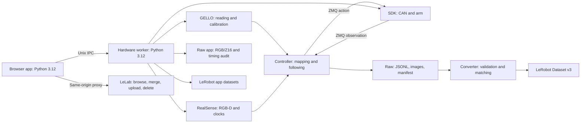

# Documentation and architecture

English | [简体中文](../zh/index.md)

The CLI controller and browser collection app are parallel entry points sharing device configuration, a hardware lock and low-level clients.

## Navigation

- [Installation](installation.md) and [usage](usage.md)
- [CLI](reference/cli.md), [configuration](reference/config.md) and [submodule configuration](reference/submodule-config.md)
- [RGB-D and timing](cameras.md), [troubleshooting](reference/errors.md)
- [Project home](../../README.md) and [contributing](../../CONTRIBUTING.md)

## Ownership

The controller composes clients and owns session/episode lifecycle. The browser app orchestrates the same hardware through a separate worker; neither entry point replaces the other.

| Runtime | Environment | Ownership |
| --- | --- | --- |
| Controller, GELLO base and camera | Root `.venv`, Python 3.12 | Leader serial, camera, robot client, raw and app state |
| SDK server | SDK `.venv`, Python 3.12 | CAN, arm feedback and commands |
| Converter | Converter `.venv`, Python 3.12 | Read raw; write a new dataset |
| Browser/LeLab | `third-party/agilex-adapters/.venv`, Python 3.12 | UI, preview encoding and LeLab integration |
| Hardware worker/adapters | Root and adapters environments, Python 3.12 | Reuse low-level initialization and cleanup |

`RobotClient` adapts the existing SDK ZMQ REQ/REP protocol, including pickle `method/args` messages. Keep the SDK endpoint local/trusted. Browser adapters use owner-private Unix IPC; do not expose that IPC over TCP.

GELLO exposes `agilex_gello_software`, `GelloAgent.act()` and explicit cleanup with real-device safeguards. Pass calibration through `DynamixelRobotConfig`; follower mapping remains in the application.

## CLI lifecycle

1. Validate configuration and acquire the shared lock.
2. Check serial permissions and the SDK endpoint, prepare CAN and validate feedback.
3. Read GELLO, display the target and wait for motion confirmation.
4. If enabled, warm up RGB-D and verify host-aligned timing; camera wrappers also request preview. Start the session-owned SDK subprocess and await seven-element RPC state.
5. Use small JS steps to zero and align before following, with startup error checks.
6. On Ctrl+C/SIGTERM/error, stop commands, close the leader/client, then attempt JS zeroing with a fresh client and stop the owned SDK server.
7. Close the camera and flush images/raw. Automatic conversion runs only after normal cleanup and with saved episodes.

The SDK subprocess is not killed before zeroing by terminal Ctrl+C. Initialization defers interruption until resource ownership is established; cleanup masks repeated stop signals. RPC, zeroing and disk failures remain visible. Saved raw can be converted separately.

`--existing-server` skips local CAN/SDK preflight and server management, but still performs confirmation, startup alignment and exit zeroing.

## Browser lifecycle

1. `serve` prepares CAN through the SDK script before starting the web process; simulation skips this.
2. Validate task and motion confirmation before launching the Python 3.12 worker.
3. Acquire the shared lock, reuse hardware helpers, warm up the camera, zero and align.
4. Exchange adapter actions over private Unix IPC. Encode preview outside control/recording threads at the dataset target rate.
5. Persist sampled frames, RGB/Z16 and timing audit. Watchdog cleanup handles stopped control; normal shutdown cleans hardware before dataset flushing.
6. Official LeRobot writes v3 directly; same-origin LeLab routes provide browsing, merge, upload and local deletion.

## Samples

At the default 50 Hz, the controller reads and maps the leader, limits the six arm joints, sends the final action and obtains observation. The gripper is passed separately.

Raw v1/v2 rows contain `sequence`, `command_time_ns`, `observation_time_ns`, `wall_time_ns`, `control_period_ns`, seven-element `action`, `joint_positions`, `joint_velocities`, `ee_pos_quat`, and scalar `gripper_position`. Units are rad, rad/s, m and xyzw quaternions. The seventh command dimension is the gripper, not a seventh arm axis. Observation time approximates client receipt; converter matching is separate.

## Persistence

R creates `.jsonl.partial`; S flushes and atomically publishes `.jsonl`; D discards the active partial. Interrupted active episodes remain partial and are ignored by conversion. A session produces one dataset and cannot overwrite an existing output.

Raw v2 adds asynchronous RGB/depth files. Saving publishes camera directories before the final joint JSONL; that joint file is the completion marker. Orphan camera directories do not independently convert. Without camera, v1 remains compatible. See [RGB-D](cameras.md).

Browser `data/raw/app/` is a separate audit format, paired with direct `data/lerobot/app/` output. It preserves RGB uint8, native Z16, calibration, clock offsets and timestamps; it is not legacy converter input.

## Child repositories

| Project | Documentation | Contributions |
| --- | --- | --- |
| GELLO | [README](../../third-party/agilex-gello-software/README.md) | Not provided |
| SDK | [README](../../third-party/agilex-sdk-python/README.md) | Not provided |
| Camera | [README](../../third-party/camera-submodule-d455f/README.md) / [stream API](../../third-party/camera-submodule-d455f/docs/stream.md) | [Guide](../../third-party/camera-submodule-d455f/CONTRIBUTING.md) |
| Converter | [README](../../third-party/lerobot-converter/README.md) / [data flow](../../third-party/lerobot-converter/docs/index.md) | [Guide](../../third-party/lerobot-converter/CONTRIBUTING.md) |
| Adapters | [README](../../third-party/agilex-adapters/README.md) | Not provided |
